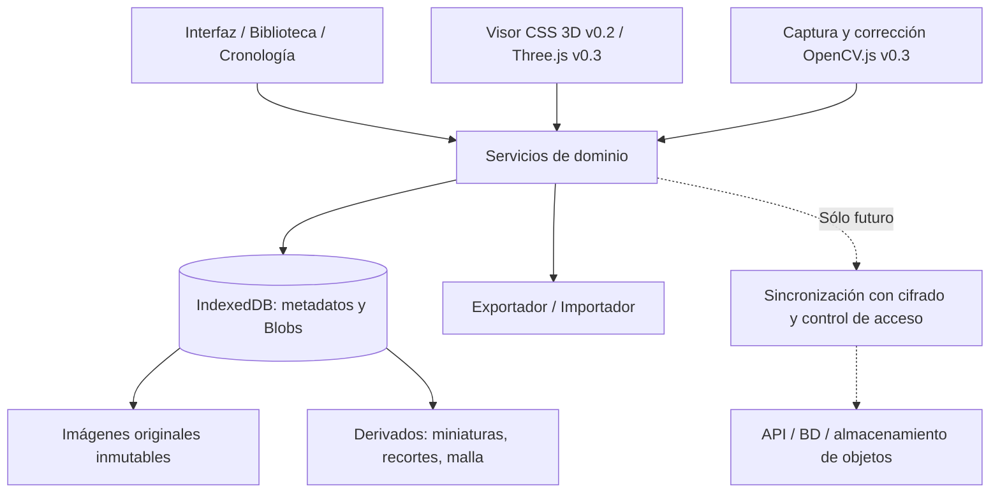

# Arquitectura y modelo técnico — Archivito

**Versión de diseño:** 0.2 como base / 0.3 como siguiente incremento (2026-11-22).

## 1. Decisión arquitectónica

Arquitectura **local-first**. Durante el MVP la información reside en el navegador del usuario mediante IndexedDB. No se necesita cuenta ni servidor para guardar o leer las cartas. La sincronización privada es una etapa posterior y requerirá modelado de seguridad propio.

## 2. Módulos previstos

| Módulo | Responsabilidad | Estado |
|---|---|---|
| Biblioteca | CRUD, búsqueda, categorías, favoritos y cronología | Prototipo 0.2 externo |
| Persistencia | Almacenamiento local y recuperación de registros | Prototipo 0.2 externo; validación real pendiente |
| Importación/exportación | Compatibilidad de formatos 0.1/0.2, errores y respaldos | Prototipo 0.2 externo |
| Visor | Textura del frente y reverso, órbita/zoom/páginas | CSS 3D en prototipo; Three.js planeado |
| Digitalización | Cuatro esquinas, homografía, previsualización, no destructivo | 0.3 pendiente |
| Preservación | Hashes, inventario, integridad, restauración | 0.4 pendiente |
| Compartición | Cuentas, autorización, cifrado y sincronización | 1.0 futura |

## 3. Modelo de dominio

- **Recuerdo**: `id`, `kind` (carta/foto/postal/sobre/etc.), `title`, `date`, `from`, `to`, `note`, `tags[]`, `favorite`, `createdAt`, `updatedAt`.
- **Página**: `id`, `recuerdoId`, `order`, `caption`, `frontAssetId`, `backAssetId?`.
- **Activo original**: `id`, `blob`, `mimeType`, `size`, `originalFilename?`, `sha256?`, `createdAt`. El Blob original se mantiene sin sobrescribir.
- **Activo derivado**: `id`, `sourceAssetId`, `kind` (thumbnail/perspective-corrected/mesh/transcription), `blob|text`, `parameters`, `createdAt`. Siempre apunta al original.
- **Colección**: `id`, `title`, `recuerdoIds[]` (posterior).
- **Relación entre recuerdos**: `id`, `fromRecuerdoId`, `toRecuerdoId`, `type` (por ejemplo `contains`: sobre→carta; posterior).

En el prototipo 0.2 los `Blob` están embebidos en los registros de las páginas. La separación en activos es **una migración propuesta para 0.3**, no una descripción del esquema actualmente implementado.

## 4. Flujo de captura 0.3

1. Cargar fotografía del celular y conservar copia **original**.
2. Detectar bordes si es posible; ofrecer cuatro esquinas editables en todos los casos.
3. Validar geometría de las cuatro esquinas y calcular una homografía (OpenCV.js).
4. Generar **derivado** corregido; mostrar comparación antes/después.
5. Guardar derivado y parámetros de procesamiento, sin reemplazar el original.
6. Construir texturas frente/dorso para visor y miniatura para biblioteca.

## 5. Visor físico 0.3

Three.js con una malla discretizada para el papel, material por cara, iluminación controlada y curvatura ajustable. **No afirmar que esta geometría revela los dobleces reales**. Controles: órbita con mouse o gesto, zoom, frente/dorso, siguiente/anterior página, reset, modo lectura 2D. Manejar texturas grandes, liberación de recursos GPU y degradación si WebGL no está disponible.

## 6. Datos, respaldo y migración

- En 0.2, IndexedDB usa `nuestro-archivo-cartas-v1` / store `letters` y admite importación `nuestro-archivo-v1` y `nuestro-archivo-v2`.
- El respaldo JSON 0.2 incluye imágenes codificadas y **no está cifrado**.
- A partir de la integración, mantener muestras sintéticas para pruebas y aplicar versionado explícito de esquema.
- Migraciones deben ser reversibles mediante export previo y pruebas de compatibilidad; no sobrescribir silenciosamente IDs en conflictos.
- El navegador puede eliminar datos; exportar y **probar restauración** es parte de la operación segura.
- Para colecciones grandes, planificar paquete por archivos/streaming: JSON base64 no escala bien.
- La eventual nube debe tratar metadatos, binarios, autorización, claves y conflictos por separado.

## 7. Fronteras de seguridad

El repositorio es **público**. Sólo alojar código, documentación y fixtures ficticios. No enviar originales a telemetría, errores remotos, IA/OCR externo ni servicios de imágenes sin consentimiento explícito. Consultar [Privacidad y preservación](PRIVACIDAD_Y_PRESERVACION.md).

## 8. Decisiones pendientes

Formato del respaldo portable 0.4; diseño de cifrado y recuperación de clave; manejo HEIC/HEIF; política de duplicados; compatibilidad mobile/touch; estrategia de autenticación/compartición y control de conflictos en la etapa 1.0.
