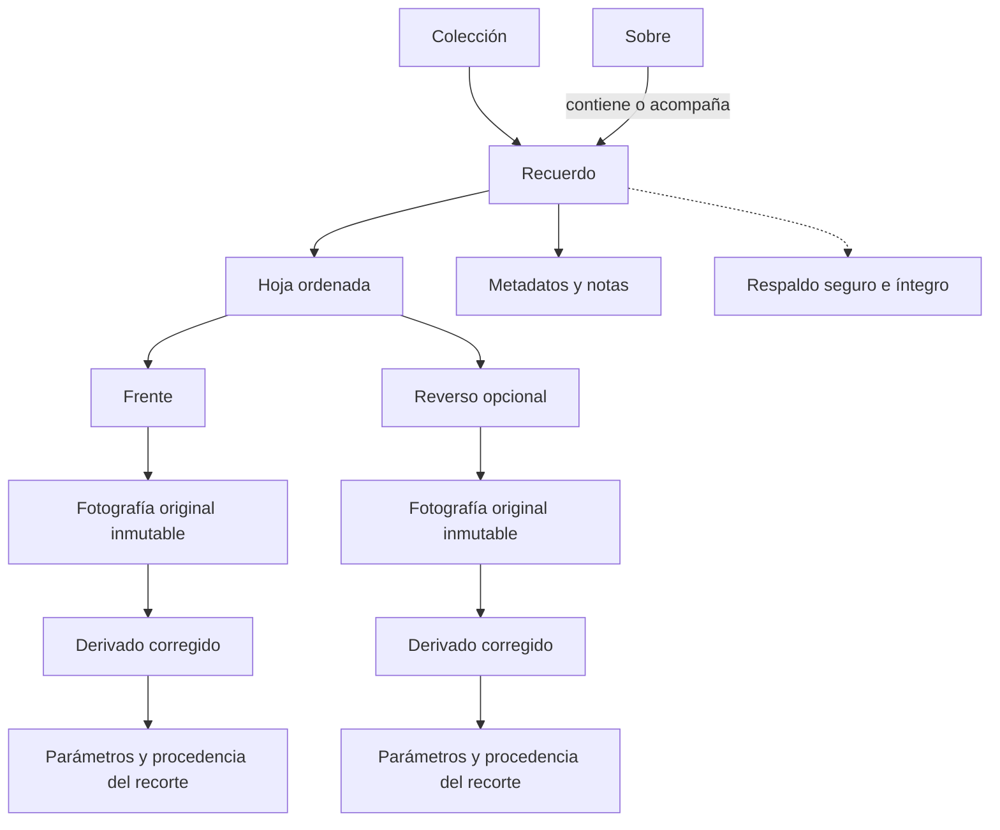

# Archivito — mapa funcional, estado y prioridades

**Corte de análisis:** 22 de noviembre de 2026  
**Ámbito:** biblioteca privada y local de cartas, fotografías, sobres y otros recuerdos, destinada eventualmente a dos personas.  
**Fuente de estado:** código y PR de leandrito369/archivito; pruebas automatizadas de CI y validaciones manuales informadas por el usuario.

> **Distinción de estado:** la rama main contiene 0.3A.3 (PR #5–#9 fusionados), con visor CSS 3D y digitalización. El visor Three.js 0.3B.1 está implementado en PR #11, CI aprobada y validado manualmente en Firefox, **pero aún no fusionado en main**. No se considera implementada en producción una función sólo planificada o en PR.

## 1. Objetivo y recorrido de usuario

**Objetivo de producto:** preservar la imagen y el contexto de un recuerdo físico, localizarlo y manipularlo digitalmente sin perder el material de origen. La experiencia futura incluye compartirlo de forma privada entre dos personas, pero **no** es un requisito para el MVP local.

**Recorrido completo deseado:**

1. Capturar o importar imágenes del frente, reverso y de varias hojas.
2. Enderezar/corregir perspectiva y conservar fotografía original y derivado por separado.
3. Registrar título, fecha, remitente, destinatario, notas, etiquetas, vínculos y colecciones.
4. Encontrar el recuerdo en biblioteca, favoritos, línea del tiempo o colecciones.
5. Leerlo en 2D o explorarlo como objeto 3D aproximado; navegar hojas y caras.
6. Exportar un respaldo seguro, verificarlo y restaurar sin pérdida ni duplicados.
7. En una etapa futura, compartir una colección con permisos y sincronización cifrada.

## 2. Convenciones

- **P0 / imprescindible:** seguridad de datos, preservación o funcionamiento básico; no postergar si expone recuerdos a pérdida.
- **P1 / próxima:** valor de producto alto o mejora necesaria para uso cotidiano.
- **P2 / mejora:** optimización o facilidad que no bloquea la biblioteca.
- **P3 / horizonte:** depende de infraestructura y decisiones de seguridad posteriores.
- **Main:** función integrada en la rama principal. **PR #11:** implementada en borrador, no integrada. **Parcial:** existe parte del alcance. **Pendiente:** aún no implementada.
- **Versión objetivo:** propuesta, no compromiso de fecha ni de disponibilidad.

## 3. Mapa de requisitos funcionales

| ID | Módulo / función | Estado comprobado | Prioridad | Próximo corte |
|---|---|---|---|---|
| **RF-01** | Biblioteca: alta, lectura, edición y borrado de recuerdos | **Main** | P0 | Mantener regresiones |
| **RF-02** | Hojas ordenadas con fotografías frente y reverso opcional | **Main** | P0 | Mantener regresiones |
| **RF-03** | Datos de cada recuerdo: tipo, título, fecha, remitente, destinatario, notas y etiquetas | **Main** | P1 | Validar fechas y procedencia |
| **RF-04** | Búsqueda, favoritos, filtros y cronología | **Main** | P1 | Mejorar filtros combinados |
| **RF-05** | Cargar y conservar fotografías originales por cara, sin modificación destructiva | **Main** | P0 | Hash y comprobación de integridad |
| **RF-06** | Digitalización manual: seleccionar cuatro esquinas, corregir perspectiva y previsualizar | **Main** | P0 | Mantener; mejorar errores |
| **RF-07** | Guardar derivado de frente/reverso vinculado a su fuente; editar hojas existentes | **Main** | P0 | Mantener; mejorar trazabilidad |
| **RF-08** | Visor de lectura y CSS 3D: giro, zoom, frente/reverso, varias hojas | **Main** | P0 | Fallback permanente |
| **RF-09** | Visor físico con Three.js: malla, grosor, curvatura, texturas y órbita | **PR #11** | P1 | Revisar y fusionar 0.3B.1 |
| **RF-10** | Modo 2D ante fallo de WebGL y alternancia de originales/derivados | **PR #11** (el CSS anterior ya existe) | P1 | QA manual y CI |
| **RF-11** | Importación/exportación de respaldos v1, v2 y v3 | **Main** | P0 | Evolución segura a v4 |
| **RF-12** | Importación atómica tras validación de archivos, sin registros a medias | **Main** | P0 | Manejo explícito de IDs repetidos |
| **RF-13** | Respaldo **cifrado** y restauración integral verificable | **Pendiente**; JSON v3 es texto claro | **P0** | **0.4A** |
| **RF-14** | Integridad SHA-256 persistida para originales, derivaciones y backups | **Pendiente**; hashes actuales sólo se usan en tests | **P0** | **0.4A** |
| **RF-15** | Diagnóstico de capacidad disponible, cuota, respaldo reciente y riesgo de borrado | **Parcial**: se solicita persistencia del almacenamiento, sin monitor completo | **P0** | **0.4A** |
| **RF-16** | Vista previa de importación, conflictos de IDs, restaurar sin pisar o duplicar | **Parcial**: aviso general y reemplazo por ID | **P0** | **0.4A** |
| **RF-17** | Modelo separado de activos originales/derivados y migraciones explícitas de IndexedDB | **Parcial**: vínculo lógico por página, blobs aún embebidos | P1 | 0.4B |
| **RF-18** | Papel 3D más fiel: pliegues **aproximados**, bordes, grosor regulable y lectura táctil | **Parcial**: curvatura simple en PR #11 | P1/P2 | 0.3B.2 |
| **RF-19** | Soporte confiable de imagen móvil: orientación EXIF, HEIC/HEIF y errores de formato | **Pendiente**; JPEG/PNG/WebP/GIF | P1 | 0.4B |
| **RF-20** | Optimización de fotos grandes, miniaturas, carga diferida, liberación de GPU y móvil | **Parcial**: miniaturas, límites y liberación por hoja | P1 | 0.3B.2 / 0.4B |
| **RF-21** | Relaciones entre **sobre → carta → hojas**, adjuntos y orden de apertura | **Pendiente** | P1 | 0.5A |
| **RF-22** | Colecciones temáticas y vínculos entre recuerdos | **Pendiente** | P1 | 0.5A |
| **RF-23** | Procedencia y descripción ampliada (lugar, autoría, estado físico, fecha estimada) | **Parcial**: metadatos básicos | P1 | 0.5A |
| **RF-24** | Eliminación recuperable, historial de modificaciones y deshacer | **Pendiente** | P1 | 0.4B |
| **RF-25** | Captura asistida automática de bordes con ajuste manual final | **Pendiente**; sólo cuatro puntos manuales | P2 | 0.5B |
| **RF-26** | Escaneo de varias fotos por lote o por cámara del móvil | **Pendiente** | P2 | 0.5B |
| **RF-27** | Transcripción manual editable asociada a cada cara; notas sobre la imagen | **Pendiente**; notas generales sí existen | P2 | 0.5B |
| **RF-28** | OCR manuscrito opcional, con revisión humana, sin subir contenido por defecto | **Pendiente** | P2 | 0.6 |
| **RF-29** | Detector de duplicados por hash y sugerencias de consolidación | **Pendiente** | P2 | 0.4B / 0.5 |
| **RF-30** | Aplicación instalable (PWA), caché offline de recursos y pruebas de desconexión | **Pendiente**; la app actual puede servirse localmente | P1 | 0.5A |
| **RF-31** | Dos usuarios, invitaciones y permisos privados por colección/recuerdo | **Pendiente** | P3 | 1.0 |
| **RF-32** | Sincronización cifrada con resolución de conflictos, revocación y recuperación | **Pendiente** | P3 | 1.0 |
| **RF-33** | Reconstrucción física de dobleces reales a partir de múltiples vistas | **Investigación futura**, no atribuible a dos fotos planas | P3 | Exploración |

### Qué NO debemos afirmar

- Un papel con textura y curvatura en WebGL **no es fotogrametría ni un escaneo de sus dobleces reales**.
- IndexedDB no garantiza conservación indefinida; una limpieza del navegador puede borrar recuerdos.
- Las pruebas SHA-256 automatizadas **no equivalen** a hashes persistidos en el producto.
- El respaldo JSON v3 **no está cifrado** aunque la aplicación sea local-first.
- Sincronización, cuentas, OCR y PWA **no están implementadas**.

## 4. Mapa de requisitos no funcionales

| ID | Propiedad | Exigencia medible de aceptación | Estado |
|---|---|---|---|
| **RNF-01** | Privacidad | Sin transferir fotografías ni metadatos íntimos a servidores o telemetría por defecto | Diseño local-first; vigilar dependencias |
| **RNF-02** | Integridad | SHA-256 del original al importar/capturar y comparado tras exportar/restaurar | Sólo tests; producto pendiente |
| **RNF-03** | Recuperabilidad | Restauración de una colección de prueba en un perfil limpio, con todas las caras y derivados | E2E v3 existente; respaldo cifrado pendiente |
| **RNF-04** | Compatibilidad | Pruebas de CRUD, visor y digitalización en Firefox y Chromium; evaluación móvil | Navegadores escritorio validados; móvil pendiente |
| **RNF-05** | Accesibilidad | Operar funciones críticas sin mouse, con controles etiquetados y lectura 2D | Parcial; auditoría completa pendiente |
| **RNF-06** | Rendimiento | Carga bajo demanda y no agotar memoria con fotos grandes o al pasar hojas | Controles iniciales; presupuesto medible pendiente |
| **RNF-07** | Seguridad | Respaldo cifrado autenticado, política de contraseña/clave, error ante corrupción, sin exposición en Git | Pendiente cifrado |
| **RNF-08** | Portabilidad | Mantener compatibilidad v1/v2/v3; migrar con posibilidad de recuperar versión previa | Compatibilidad existente; migración estructural pendiente |
| **RNF-09** | Mantenibilidad | Pruebas automatizadas de regresión, PRs pequeños, cambios de modelo documentados | CI integrada |
| **RNF-10** | Fidelidad documental | Original siempre recuperable; toda transformación vinculada, explícita y reversible | Funcional en v3; falta manifest de integridad |

## 5. Modelo de dominio objetivo y relaciones

**Nota de implementación:** hoy Original y Derivado están vinculados lógicamente como blobs dentro de la página en IndexedDB; el diagrama muestra el **modelo conceptual objetivo**, no tablas físicas actuales. No separar stores ni migrar la base sin una prueba de restauración y rollback.

**Invariantes del producto:**

1. Reemplazar/recortar un derivado nunca sobrescribe el Blob original.
2. El reverso vacío se diferencia de un reverso con foto, pero sin digitalización.
3. Una hoja pertenece a un recuerdo y tiene orden estable.
4. La importación de respaldo debe validarse antes de aplicar escrituras; el usuario elige qué hacer con IDs repetidos.
5. El modo 3D es opcional; la lectura 2D debe ser siempre posible.
6. Cualquier mecanismo de cifrado debe probar **restauración** además de exportación, sin exponer claves en logs.

## 6. Ruta de ejecución propuesta

| Orden | Corte | Resultado verificable | Dependencia |
|---|---|---|---|
| **0** | Cierre de **0.3B.1 / PR #11** | Revisión, CI verde, validación manual confirmada; fusionar sólo tras autorización | Sin bloqueo técnico conocido |
| **1** | **0.4A.1 — Integridad y backup protegido** | Archivo de respaldo cifrado y autenticado, hashes y restauración en perfil limpio, sin perder v3 | Base integrada y copia de seguridad |
| **2** | **0.4A.2 — Recuperación y conflictos** | Previsualizar cambios, elegir fusionar / reemplazar / omitir; estimar tamaño y advertir cuota | 0.4A.1 |
| **3** | **0.3B.2 — Robustez del visor** | Validación en Firefox/móvil, memoria, fallback, orientación de texturas, interacción táctil | PR #11 integrado; independiente de backup |
| **4** | **0.4B — Mantenimiento de activos** | Modelo de activos/migraciones versionadas, borrado recuperable, formatos móviles | Backup probado |
| **5** | **0.5A — Biblioteca relacional** | Sobre→carta, colecciones y metadatos de procedencia | Modelo estable |
| **6** | **0.5B / 0.6 — Captura y lectura avanzada** | Bordes automáticos corregibles, lote, transcripción, OCR local opcional | Preservación confiable |
| **7** | **1.0 — Compartición privada** | Acceso de dos personas con permisos y sincronización protegida | Modelo de amenazas y cifrado |

### Decisión de prioridad

**Propuesta inmediata:** cerrar el corte 0.3B.1 y dedicar el siguiente PR funcional a **0.4A.1 (respaldo cifrado + integridad)**, enlazándolo al [Issue #4](https://github.com/leandrito369/archivito/issues/4). El aspecto 3D ya ofrece valor; la pérdida o exposición de cartas personales es un riesgo mayor. La ampliación estética 0.3B.2 puede avanzar después, en una rama independiente si no toca almacenamiento.

## 7. Criterios de salida para el siguiente corte (0.4A.1)

- Exportar una biblioteca sintética de varias hojas con frente, reverso y derivados.
- Generar un respaldo cifrado **v4**, con contraseña elegida por el usuario y cifrado autenticado; nunca guardar contraseña/clave.
- Confirmar que contenido y metadatos de cartas no aparecen en claro en el archivo cifrado.
- Importar v4 en otro perfil Firefox/Chromium con contraseña correcta; comparar hashes de originales y derivados.
- Rechazar contraseña errónea y respaldos alterados **sin escritura parcial**.
- Mantener importación v1/v2/v3 (advertencia: formatos sin cifrar) y exportación de recuperación según política.
- Advertir sobre la irreversibilidad de una contraseña perdida, límites de cuota y tamaño del backup.
- CI verde con fixtures enteramente ficticios; prueba manual de restauración antes de merge.

## 8. Referencias de gobierno

- [PR #11 — Three.js 0.3B.1](https://github.com/leandrito369/archivito/pull/11) — implementación experimental confirmada manualmente, pendiente de merge.
- [Issue #2](https://github.com/leandrito369/archivito/issues/2) — deuda de activos independientes y mejoras de captura.
- [Issue #3](https://github.com/leandrito369/archivito/issues/3) — visor 3D y hardening.
- [Issue #4](https://github.com/leandrito369/archivito/issues/4) — integridad y respaldos cifrados.
- [Privacidad y preservación](PRIVACIDAD_Y_PRESERVACION.md).
- [ADR-0001](decisiones/ADR-0001-local-first.md).

**Restricción permanente:** este repositorio es público. Ninguna fotografía real, respaldo privado, contraseña ni dato íntimo debe incluirse en commits, issues, logs o evidencias de CI.
