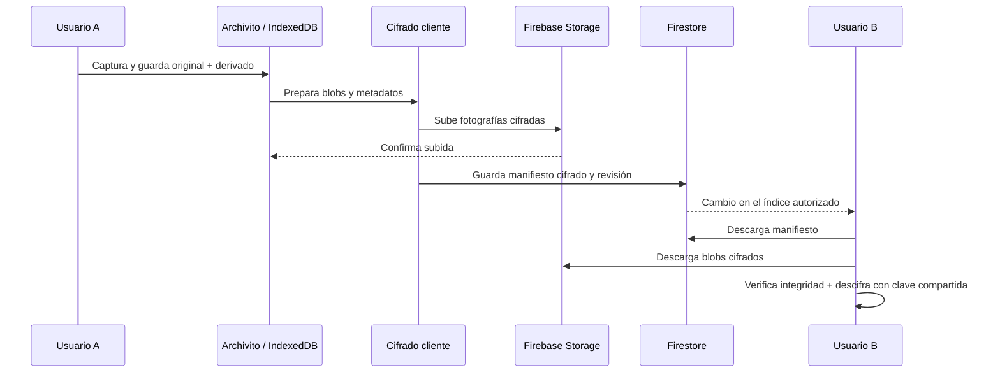

# Plan de entrega — Archivito web privado para dos personas

**Propuesta:** 22/11/2026 · **Estado:** diseño y backlog, **no desplegado**.

## Resultado que buscamos

Desde una sola dirección HTTPS (por ejemplo `https://NOMBRE-DEL-PROYECTO.web.app`), dos personas distintas pueden entrar con **sus propias cuentas de Google**, subir una carta desde el celular o la PC, navegar en el visor 2D/3D y verla sincronizada en el dispositivo de la otra persona. Sólo esos dos usuarios están autorizados.

El acceso por Google significa **Google Sign-In**, no que las cartas se indexan en Google Search, ni que hay que compartir una contraseña. El código del sitio puede servirse públicamente; **las fotos, notas y metadatos sensibles se cifran y autorizan**.

## Estado actual vs estado requerido

| Capacidad | Actual (`main`) | Requerido para ambos |
|---|---|---|
| Interfaz web y visor | Sí, desde servidor local | Hosting HTTPS |
| Inicio de sesión Google | No | Auth y allowlist de dos UIDs |
| Biblioteca | IndexedDB por origen y navegador | Colección remota común + caché local |
| Originales y derivados | Blobs locales | Blobs **cifrados localmente** en Cloud Storage |
| Metadatos | JSON/objetos locales | Firestore con contenido sensible cifrado |
| Sincronización | No | Suscripción a cambios y cola de operaciones |
| Uso offline | Datos locales, sin sincronización | Outbox local, reintentos y conflictos |
| Backup | JSON v3 no cifrado | v4 protegido, autenticado y restaurable |
| Instalación como app | No PWA | Manifest + service worker + pantalla de inicio |
| Reglas de acceso | No, no hay backend | Firestore + Storage con deny-all inicial |
| Compartir/revocar acceso | No | Miembros por UID, rol owner/editor, revocación |

## Fases y dependencias

### A. Seguridad y preservación (Issue #4, `0.4A.1`)

- [ ] Exportación cifrada y autenticada v4, compatible con v1/v2/v3 en importación.
- [ ] Manifest SHA-256 de originales/derivados y verificación tras restauración en perfil limpio.
- [ ] Rechazo sin escrituras ante contraseña incorrecta, corrupción o versión no admitida.
- [ ] Gestión documentada de claves y pérdida de contraseña. **Este backup no habilita por sí solo nube compartida.**

**Criterio de aceptación:** una carta de dos hojas y ambas caras restaura byte a byte; archivo alterado no escribe nada.

### B. Preparar hosting + identidad (`CLOUD-01`)

- [ ] Crear proyecto propio en https://console.firebase.google.com/ y registrar una app web.
- [ ] Evaluar y activar el plan Blaze **sólo cuando el propietario apruebe facturación**; presupuesto/alertas y uso de región documentados.
- [ ] Habilitar Google Sign-In, registrar dominios autorizados, verificar flujo móvil Safari/iOS y Android/Chrome.
- [ ] Migrar despliegue de páginas HTML actuales a build estático repetible (por ejemplo Vite multi-page) para no publicar `node_modules` ni secretos.
- [ ] Preparar Firebase Hosting y política de caché, HTTPS, sin exponer recursos privados en carpeta pública.
- [ ] Crear archivo privado `archives/{archiveId}` y dos membresías explícitas por UID.
- [ ] Reglas Firestore/Storage **deny-by-default** con pruebas en emuladores: los dos UIDs permitidos acceden; terceros y anónimos reciben rechazo.
- [ ] Crear entornos aislados de desarrollo y producción; sin datos reales en desarrollo.

**Criterio de aceptación:** dos cuentas distintas ingresan desde dos navegadores/ubicaciones, pueden ver una **carta ficticia**; terceros no pueden acceder por API. El código web público no implica lectura pública de datos.

### C. Cifrado extremo a extremo + sincronización (`CLOUD-02`)

- [ ] Especificar keyring, recuperación, entrega segura de clave de archivo a la pareja y rotación.
- [ ] Cifrar originales/derivados y metadatos privados **antes de subir**; no almacenar clave en servidor.
- [ ] Crear adaptador `LocalRepository`/`CloudRepository` sin romper modelo de dominio 0.3A.
- [ ] Subir assets cifrados con IDs aleatorios, reintentos e integridad, luego confirmar índice de metadatos.
- [ ] Sincronizar versiones por `revision`, operaciones idempotentes, IDs estables y resolución de conflictos.
- [ ] Estado de subida visible: `Sólo local`, `Pendiente`, `Subiendo`, `Sincronizado`, `Conflicto`, `Error`.
- [ ] Evitar vínculos de descarga públicos/compartibles a fotos. Verificar lectura únicamente con SDK autenticado.
- [ ] Probar dos sesiones simultáneas con pérdida/reconexión a Internet.

**Criterio de aceptación:** usuario A sube una carta ficticia con original y derivado; usuario B la ve sin refrescar manualmente, con todos sus metadatos, y solo puede hacerlo con autorización y clave local.

### D. Migrar recuerdos locales y habilitar uso cotidiano (`CLOUD-03`)

- [ ] Explicar que `localhost:8000` y `*.web.app` son orígenes distintos: **el navegador no mueve IndexedDB automáticamente**.
- [ ] Importar backup en la nueva URL únicamente tras consentimiento de usuario, cifrado y confirmación de espacio disponible.
- [ ] Evitar duplicados por IDs, comparar hashes y permitir revisión previa.
- [ ] Respetar el original: si falla subida, no borrar ni modificar el dato local.
- [ ] Instalar manifest PWA y service worker de recursos públicos; no precachear cartas sensibles.
- [ ] Probar subida desde iPhone Safari/Chrome, Android Chrome y Firefox/Chrome en PC.
- [ ] Comprobar que los dos usuarios pueden subir y que los cambios persisten desde cualquier lugar.

**Criterio de aceptación:** cada persona incorpora un recuerdo ficticio desde un dispositivo distinto, lo ve en el otro, puede leerlo offline si está disponible localmente, y el estado de sincronización no miente.

### E. Operación segura (`CLOUD-04`)

- [ ] Backup v4 regular y restauración de prueba incluso si se pierde una cuenta/dispositivo.
- [ ] Protección contra borrado accidental: papelera o versiones recuperables.
- [ ] Gestión de revocación de cuentas y pérdida de dispositivos; aclarar que archivos ya descargados no pueden des-descargarse remotamente.
- [ ] Vigilancia de costos, errores de sincronización, cuotas y tamaño de archivos, sin telemetría de contenido.
- [ ] Documentar cierre de sesión y eliminación de copias locales.

## Experiencia en el celular y en PC

1. Abrir el mismo enlace `https://…web.app` en Chrome/Firefox/Safari.
2. Pulsar **Entrar con Google**. Cada persona usa su propia cuenta.
3. Si está autorizado, abrir el archivo compartido; si no, mostrar **Acceso restringido**.
4. Pulsar **Nueva carta** y fotografiar o adjuntar frente y reverso desde la cámara/galería.
5. Recortar o enderezar, guardar y consultar un indicador de sincronización.
6. La otra persona ve la carta una vez sincronizada y puede abrirla en 2D/3D.
7. Opcional: añadir Archivito a pantalla de inicio como PWA, sin obligación de instalar desde Play Store/App Store.

**Condición importante:** la app puede cargar una fotografía mientras no hay Internet y dejarla en la cola local, pero la otra persona **no la verá** hasta que el dispositivo remitente consiga subirla.

## Arquitectura de datos y orden de subida

El proceso no es una transacción única de Firestore y Storage: se necesitan **estados de upload, idempotencia, limpieza de huérfanos y reintentos**.

## Política de acceso inicial (estrictamente dos personas)

- El dueño administra `archiveId` y dos documentos de membresía `memberUid`.
- El segundo usuario tiene permisos de lectura/alta/edición. Para borrado compartido, exigir papelera y/o rol propietario al principio.
- Crear las membresías mediante una operación administrativa autenticada segura. **No** permitir que una persona se añada a sí misma escribiendo `/members/{suUID}`.
- La consola Firebase y las cuentas administradoras de la nube deben tratarse por separado de la membresía de la app.
- Las reglas deben controlar también el acceso a fotografías; no basta ocultar botones en la interfaz.

## Decisiones que requieren intervención del propietario

1. Crear y poseer el proyecto Firebase, aceptar o no Blaze y configurar la facturación; no enviar datos bancarios al chat.
2. Conectar la integración Firebase si quiere que ChatGPT pueda intervenir en configuración/despliegue desde el servicio.
3. Elegir las dos cuentas Google mediante el flujo real de autenticación: usar **UIDs** internamente; no publicar correos personales en el repositorio.
4. Aprobar cómo compartir y recuperar la clave de cifrado entre ambos.

## Consideraciones de costo y privacidad

Firebase Cloud Storage requiere Blaze en 2026 (pago por uso); existen cuotas gratuitas según producto y ubicación. **Las alertas de presupuesto no equivalen a un límite de cargos**. Estimar después de medir volumen real.

El Firebase Web SDK almacena y sincroniza documentos Firestore cuando está configurado para offline; las fotografías en Cloud Storage requieren una lógica propia de subida/caché. Evitar usar enlaces públicos descargables con tokens persistentes.

El sistema local actual sigue funcionando sin migración automática. **No subir cartas personales a la nube durante el desarrollo**, sólo fixtures sintéticos.

## Enlaces oficiales de referencia

- Firebase Console: https://console.firebase.google.com/
- Google Sign-In: https://firebase.google.com/docs/auth/web/google-signin
- Firebase Hosting: https://firebase.google.com/docs/hosting/quickstart
- Persistencia offline Firestore: https://firebase.google.com/docs/firestore/manage-data/enable-offline
- Firestore Security Rules: https://firebase.google.com/docs/firestore/security/rules-conditions
- Cloud Storage Rules y Firestore: https://firebase.google.com/docs/storage/security/rules-conditions
- Facturación Storage: https://firebase.google.com/docs/storage/faqs-storage-changes-announced-sept-2024
- Alertas y límites de facturación: https://firebase.google.com/docs/projects/billing/avoid-surprise-bills

## Gobernanza

- Un PR por fase, sin tocar datos reales de producción o desplegar automáticamente.
- Commits nuevos, no reescritura de historia.
- CI con emuladores y pruebas negativas de permisos, tests de cifrado y restauración; aprobar/merge sólo tras verificaciones.
- Documentar cada migración IndexedDB y contar con respaldo v4 restaurado en perfil limpio.
