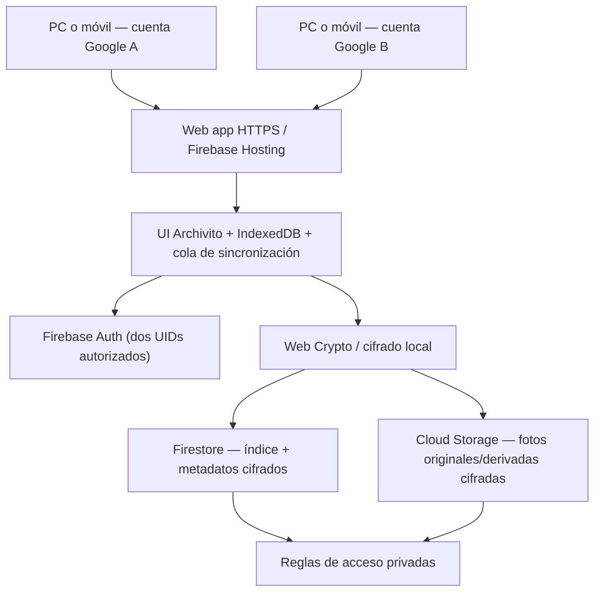

# ADR-0002 — Firebase (alternativa descartada)

- **Fecha:** 2026-11-22
- **Estado:** **sustituida** por [ADR-0003 — Cloudflare Pages + Supabase Free](ADR-0003-cloudflare-supabase.md). No implementar Firebase a partir de esta ADR.
- **Alcance:** acceso desde celular/PC y desde cualquier lugar, dos usuarios autorizados, alta y lectura de recuerdos sincronizados
- **Decisión anterior:** [ADR-0001: local-first](ADR-0001-local-first.md)
- **Plan vigente:** [ADR-0003](ADR-0003-cloudflare-supabase.md) y [Plan de acceso web compartido](../PLAN_ACCESO_WEB_COMPARTIDO.md)

**Nota histórica:** este documento conserva las hipótesis anteriores para trazabilidad. La arquitectura vigente propuesta utiliza **Cloudflare Pages + Supabase Free**, no Firebase.

## Contexto

Actualmente Archivito corre en localhost, con los datos guardados exclusivamente en IndexedDB en el navegador. El visor Three.js 0.3B.1 ya está integrado en `main`, pero no existe servicio remoto. Abrir un enlace desde otro teléfono o PC, otra cuenta o incluso otra URL no da acceso al mismo IndexedDB.

El objetivo del usuario es que **dos personas**, cada una con su **propia cuenta Google**, puedan añadir una carta desde cualquier lugar y verla desde sus dispositivos sin compartir contraseñas.

Las fotografías pueden incluir correspondencia privada. La disponibilidad desde Internet no implica que los recuerdos deban ser públicos.

## Decisión propuesta

Adoptar **Firebase** para una implementación web progresiva, manteniendo la arquitectura local-first y sin publicar recuerdos reales hasta validar seguridad:

1. **Firebase Hosting:** servir los recursos estáticos de Archivito mediante HTTPS en una URL `https://<proyecto>.web.app`, o dominio propio posterior. El código web es accesible públicamente; **los datos no**. Un `noindex` no es control de acceso.
2. **Firebase Authentication (Google):** inicio de sesión separado para cada una de las dos cuentas.
3. **Cloud Firestore:** guardar sólo índice y metadatos mínimos necesarios para sincronización, más membresía y control de versiones; cifrar metadatos sensibles antes de subir.
4. **Cloud Storage for Firebase:** guardar las fotografías **cifradas en el dispositivo**, con paths aleatorios y reglas de autorización. Nunca generar enlaces públicos permanentes a cartas privadas.
5. **IndexedDB:** conservar copias locales, consulta offline y cola de cambios; los documentos de Firestore pueden tener persistencia offline, pero **eso no sube automáticamente las imágenes offline a Storage**.
6. **Criptografía del lado cliente:** contenido cifrado antes de subir; el servidor almacena ciphertext. El inicio de sesión de Google prueba identidad, **no sustituye** cifrado de extremo a extremo ni respaldo con recuperación.
7. **Reglas de seguridad:** denegar por defecto; permitir leer/escribir sólo si `request.auth.uid` pertenece a la membresía del archivo. Membresía creada/invitada por el propietario, sin autoinscripción. Las reglas se prueban en emuladores antes del primer despliegue.

## Modelo conceptual

**Frontera de confianza:** Google/Firebase transporta y almacena datos cifrados, pero no debe recibir claves para descifrar fotos, cartas o notas. Aun usando cifrado cliente, el proveedor puede observar metadatos operativos (cuentas, tamaños, horarios, tráfico). El diseño debe documentarlos.

## Modelo de datos remoto (propuesto)

- `archives/{archiveId}`: identificador aleatorio, versión de esquema y preferencias no sensibles.
- `archives/{archiveId}/members/{uid}`: pertenencia y rol `owner` o `editor` (restringida por reglas; no editable por el usuario para concederse permisos).
- `archives/{archiveId}/memories/{memoryId}`: versión, ID aleatorio, referencias de activos y payload cifrado de título, notas, etiquetas, fecha, remitente, destinatario y orden de hojas.
- `storage/archives/{archiveId}/assets/{assetId}`: blobs cifrados originales y derivados (sin texto privado en nombres ni paths).
- `archives/{archiveId}/operations/{operationId}` si es necesario para idempotencia/concurrencia; definir al implementar.

**IDs de activos:** opacos, nunca nombres de archivos reales. Al menos dos roles, con revocación explícita. Sin endpoint público de importación.

## Flujo de alta de una carta

1. Cada usuario inicia sesión con Google en la misma URL.
2. El cliente comprueba la membresía autorizada en un archivo privado común.
3. Al elegir una fotografía, conserva el original en IndexedDB y calcula derivados.
4. Prepara cifrado/manifest local, encola la operación, sube el ciphertext de assets y confirma metadatos mediante revisión/versionado.
5. Muestra `Pendiente de subir`, `Sincronizando`, `Sincronizado` o `Conflicto`. Si no hay Internet, preserva pendientes sin afirmar sincronización.
6. La otra cuenta consulta cambios autorizados, descarga ciphertext, lo verifica, lo descifra localmente y lo muestra.
7. Nunca borrar la última copia local por una carga fallida.

## Claves y recuperación (decisión de diseño requerida)

**Requisito antes de subir fotografías privadas:**

- Crear una **clave de archivo** aleatoria de 256 bits en el dispositivo y un mecanismo de compartirla de forma segura con la segunda persona (por ejemplo código de recuperación transmitido fuera de Archivito).
- No almacenar esa clave en claro en Firestore, Storage, Analytics, GitHub ni logs.
- El diseño definitivo debe permitir que ambas personas descifren los mismos recuerdos, sin compartir sus contraseñas Google.
- Determinar cómo se recupera el archivo si se pierde un celular, cómo se rota la clave, qué pasa si se revoca un miembro y cuáles son las limitaciones de revocación de datos ya descargados.
- La copia de respaldo v4 cifrada del Issue #4 es **complementaria**: por sí sola no implementa E2EE ni sincronización.

## Riesgos de producto

| Riesgo | Control propuesto |
|---|---|
| Acceso por un tercero con cuenta Google diferente | Permisos por UID en reglas Firestore/Storage y pruebas negativas |
| Configuración accidental de Storage público | Denegar por defecto, reglas versionadas y emuladores; prohibir ACL pública |
| Captura de contraseña/clave en repositorio o logs | No introducir secretos en Git; claves sólo del lado cliente |
| Una foto no se sube pero aparece localmente | Cola persistida y estados visibles de sincronización |
| Dos ediciones simultáneas del mismo recuerdo | Revisiones, estrategia explícita de conflictos y copia recuperable |
| Pérdida/limpieza del navegador | Backup v4 probado, almacenamiento remoto verificado y copia de originales fuera de la app |
| Cambio de `localhost` a `*.web.app` | Orígenes distintos: migración por importación explícita de backup privado |
| Cuenta Google comprometida | Sesiones, revocación; cifrado de contenido limita exposición sin la clave |
| Errores de factura | Plan Blaze con límites/alertas, cuotas, monitoreo y pruebas con fixtures |

## Restricciones y criterios de salida

1. Nada de despliegue público ni sincronización real hasta tener proyecto Firebase bajo control del propietario y reglas verificadas en emulador.
2. No importar cartas reales hasta tener **cifrado de contenido en el dispositivo**, recuperación probada y controles de acceso probados (dos cuentas admitidas, tercero rechazado).
3. No migrar la base IndexedDB antigua destructivamente; el salto a un dominio HTTPS constituye un origen nuevo. Exportar/restaurar primero.
4. Código fuente, tests y configuración de ejemplo sí pueden estar en GitHub público. Cartas, tokens de servicio, claves y JSON de backups, no.
5. Pruebas E2E en Firefox escritorio, Chrome/Android y Safari/iOS antes de cerrar la primera entrega compartida.
6. Las dos cuentas pueden subir, leer y editar; borrado compartido requiere confirmación y, preferiblemente, papelera recuperable.

## Costos y condiciones operativas

- Firebase Hosting permite alojar web estática en HTTPS bajo dominio `web.app`.
- **Cloud Storage for Firebase requiere Blaze (pago por uso) en 2026**, aunque puede aplicar un nivel gratuito según recursos/región.
- Activar presupuesto y alertas; **una alerta no garantiza detener el gasto**.
- Elegir ubicación regional conscientemente: afecta latencia, costos y residencia de datos.
- No estimar un costo fijo sin tamaño real de fotos, transferencias y número de respaldos.

## Alternativas consideradas

1. **Compartir carpeta Google Drive:** más simple para fotos sueltas, pero no crea automáticamente catálogo, reglas finas, malla 3D ni sincronización transaccional de IndexedDB. Válido para respaldo manual provisional; no como arquitectura principal.
2. **Supabase Auth + PostgreSQL + Storage + hosting estático:** alternativa viable si se prioriza SQL y políticas RLS, pero mayor cantidad de decisiones de integración para el inicio Google; reevaluar si Firebase no conviene por costos u operación.
3. **Firebase sin cifrado cliente:** más rápido, pero la privacidad depende exclusivamente de autorización y proveedor. **No recomendado para la puesta en producción de correspondencia íntima.**
4. **App sólo local:** mayor simplicidad y ausencia de nube, pero no satisface uso remoto desde dos dispositivos.

## Referencias oficiales

- https://firebase.google.com/docs/hosting/quickstart
- https://firebase.google.com/docs/auth/web/google-signin
- https://firebase.google.com/docs/firestore/manage-data/enable-offline
- https://firebase.google.com/docs/storage/security/rules-conditions
- https://firebase.google.com/docs/storage/faqs-storage-changes-announced-sept-2024
- https://firebase.google.com/docs/projects/billing/avoid-surprise-bills

**Estado:** decisión propuesta, **no** implica un Firebase conectado, hosting desplegado, reglas aplicadas ni nube en operación.
