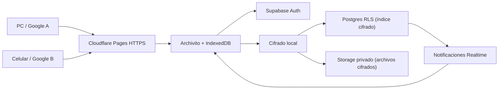

# ADR-0003 — Archivito compartido: Cloudflare Pages + Supabase Free

- **Fecha:** 2026-11-22
- **Estado:** **aceptada para planificación** por decisión del propietario; implementación y despliegue pendientes
- **Sustituye:** [ADR-0002 (Firebase)](ADR-0002-acceso-web-compartido.md)
- **Plan:** [Acceso web compartido](../PLAN_ACCESO_WEB_COMPARTIDO.md)

## Contexto y decisión

Dos personas necesitan entrar desde PC, iPhone/Android o cualquier navegador a una biblioteca privada, con sus **cuentas Google independientes**, y subir cartas desde cualquier ubicación. Actualmente cada instalación de Archivito conserva sus datos en **IndexedDB del navegador**. No existe backend, sincronización ni autenticación remota.

Se decidió evitar un servicio de fotos que requiera activar un plan de facturación: **Cloudflare Pages Free** para servir la web HTML/CSS/JS y **Supabase Free** para Google OAuth, PostgreSQL, Storage y Realtime, permaneciendo en las cuotas gratuitas. La publicación del frontend no hace públicos los recuerdos; la privacidad depende de controles en los servicios **más cifrado del lado cliente**.

## Componentes y fronteras de confianza

| Componente | Función | Restricción |
|---|---|---|
| Cloudflare Pages | Servir interfaz y módulos WebGL por HTTPS | Sólo código y recursos estáticos; sin datos privados ni secretos |
| Supabase Auth | Iniciar sesión con Google OAuth | **Autenticarse no autoriza a entrar al archivo** |
| Supabase PostgreSQL | Metadatos **cifrados** e índice de versiones | Todas las tablas expuestas con RLS; sin títulos, nombres o notas en claro |
| Supabase Storage | Blobs originales/derivados **cifrados antes de subir** | Bucket privado, rutas aleatorias, políticas en `storage.objects`, sin links públicos permanentes |
| Supabase Realtime | Notificar revisiones disponibles | Cada notificación debe obedecer las mismas restricciones RLS; no incluir contenido privado |
| IndexedDB | Copias locales, pendientes, consulta offline | No borrar fuentes locales tras subir; backup separado |
| Web Crypto | Cifrado autenticado en el cliente, verificación SHA-256 | La clave **no debe salir** del dispositivo ni estar en el repositorio |

El cifrado de respaldo v4 (Issue #4 / PR #18) protege una **copia exportada**, pero **no** constituye por sí solo el cifrado extremo a extremo ni resuelve la distribución de la clave compartida.

## Modelo conceptual inicial

Se propone un solo `archive_id` aleatorio y dos membresías explícitas por `auth.users.id`. El dueño aprovisiona la segunda membresía de forma administrativa; **ninguna cuenta puede agregarse a sí misma** mediante la API.

### Relación de datos propuesta

- `archives(id, created_at, schema_version)`: archivo privado con UUID.
- `archive_members(archive_id, user_id, role)`: autorización `owner/editor` por ID autenticado.
- `memories(id, archive_id, revision, encrypted_payload, nonce, updated_at)`: índice con contenido privado cifrado, IDs sin información personal.
- `storage.objects` bajo bucket **privado** `archivito-private`, rutas `<archive_uuid>/<asset_uuid>` que nunca incluyan nombres reales.
- Assets cifrados contienen fotos originales y derivados; sus hashes se verifican antes de usarlos.

**Esquema pendiente de implementar y auditar:** no se aplicó ninguna migración SQL ni Storage policy. No crear funciones `SECURITY DEFINER` expuestas ni confiar en `user_metadata` para permisos. Las policies deben usar `auth.uid()` con membresía verificable; `TO authenticated` por sí solo no protege los datos.

## Flujo propuesto

1. Dos usuarios acceden a la misma URL (por ejemplo `https://archivito.pages.dev`, nombre sujeto a disponibilidad).
2. Cada uno inicia sesión con Google en **su propia cuenta**.
3. Tras consultar una membresía autorizada, el cliente desbloquea una clave de archivo compartida distribuida por un canal seguro fuera de la app; si no puede, no descifra recuerdos.
4. Al crear una carta, se conservan original/derivado localmente, se calcula manifest, se cifran assets y metadatos **en el navegador**, y se ponen en cola.
5. Al recuperar Internet, se cargan primero los assets cifrados y después se confirma la revisión. El otro usuario recibe la notificación, descarga y descifra.
6. Se muestran estados claros: **solo local / pendiente / subiendo / sincronizado / conflicto / error**. Ninguna carga fallida se considera completada.

## Seguridad imprescindible

- **Negar por defecto.** Bucket privado; RLS en todas las tablas accesibles; 2 UIDs admitidos, un tercero y anónimos denegados. Las pruebas deben verificar accesos reales vía REST y Storage.
- La clave `service_role`/secreta de Supabase jamás puede aparecer en frontend, GitHub ni Cloudflare Pages. Solamente URL y **publishable key** están diseñadas para cliente; no son secretos ni sustituyen RLS.
- Se deben cifrar también **títulos, fechas, etiquetas, remitentes y notas**, no sólo fotografías.
- Sin enlaces públicos a Storage, ni publicar claves de recuperación, documentos personales, backups o fotos de usuarios.
- Resolver edición concurrente con revisión y cola idempotente; evitar sobrescritura silenciosa y borrado destructivo.
- La revocación de acceso futuro no elimina las copias ya descargadas por otra persona. Documentar pérdida/rotación de clave y dispositivo.
- El sitio web es público como **software estático**, pero las cartas deben seguir privadas y cifradas.

## Restricciones del plan gratuito

En noviembre de 2026 el plan Free de Supabase incluye hasta **1 GB de archivos**, **500 MB de base de datos**, 5 GB de egress y puede pausar el proyecto tras siete días de inactividad; ver la página de precios vigente. Cloudflare Pages Free admite un volumen limitado de compilaciones mensuales. **USD 0 es condicionado al uso dentro de cuotas y a mantener las cuentas gratuitas**. No comprometer disponibilidad continua ni backups automáticos del proveedor.

## Validación antes de subir datos reales

1. Compilar la app con dependencias locales (Three.js) y publicar **sólo datos sintéticos** en un entorno de prueba de Cloudflare.
2. Completar Google OAuth, registro de redirecciones y reglas RLS; usuario A/B admitidos, usuario C/anon rechazados.
3. Diseñar y probar clave compartida y cifrado cliente de **archivos y metadatos**.
4. Probar sincronización entre dos perfiles, modo offline, reintentos y conflictos.
5. Crear y restaurar backup v4; migrar desde localhost **explícitamente**, porque son orígenes IndexedDB distintos.
6. Validar Safari iOS, Chrome Android y Firefox PC antes de producción.

## Alternativas

- **Firebase:** descartado para esta etapa por necesidad de un plan de facturación en Cloud Storage, aunque la app pueda crecer hacia él más adelante.
- **Google Drive compartido:** permite guardar fotos pero no resuelve catálogo privado estructurado, RLS y sincronización fiable de páginas.
- **Supabase + Cloudflare (adoptado):** cuotas gratuitas apropiadas para prototipo privado de dos personas; exige disciplina de límites y seguridad.
- **Solo local:** no satisface acceso remoto compartido.

## Documentación oficial

- https://developers.cloudflare.com/pages/get-started/git-integration/
- https://developers.cloudflare.com/pages/configuration/build-configuration/
- https://supabase.com/pricing
- https://supabase.com/docs/guides/auth/social-sign-in/auth-google
- https://supabase.com/docs/guides/database/postgres/row-level-security
- https://supabase.com/docs/guides/storage/security/access-control

**No supone que exista un proyecto Cloudflare/Supabase conectado, que haya login operativo o que las cartas estén sincronizadas.**
